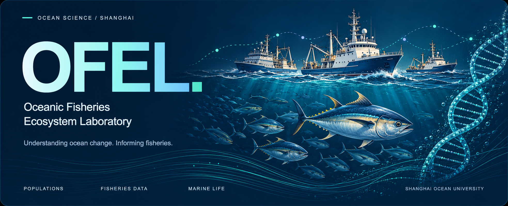
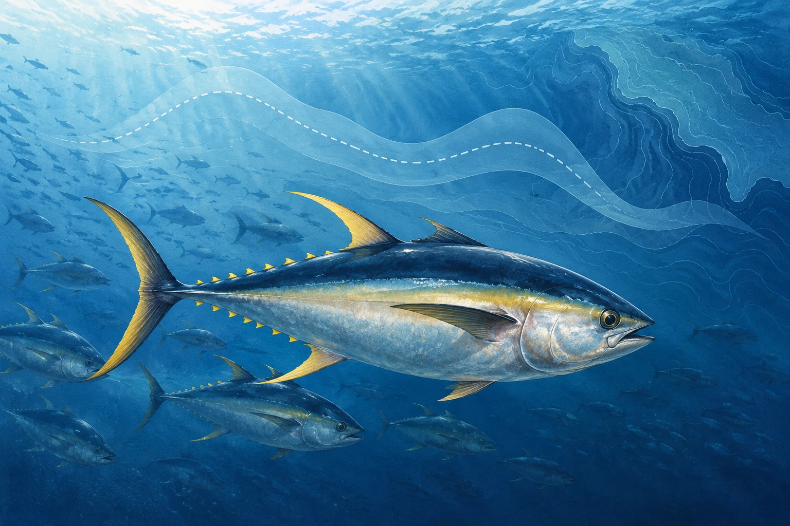
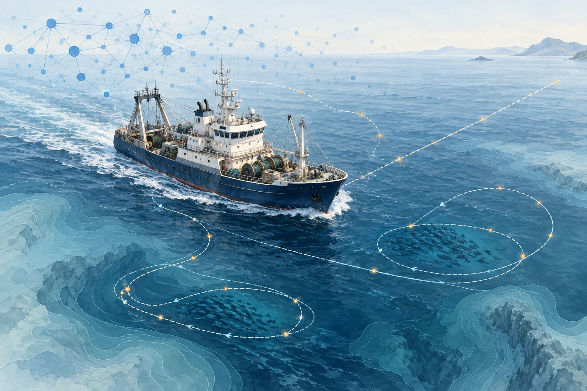
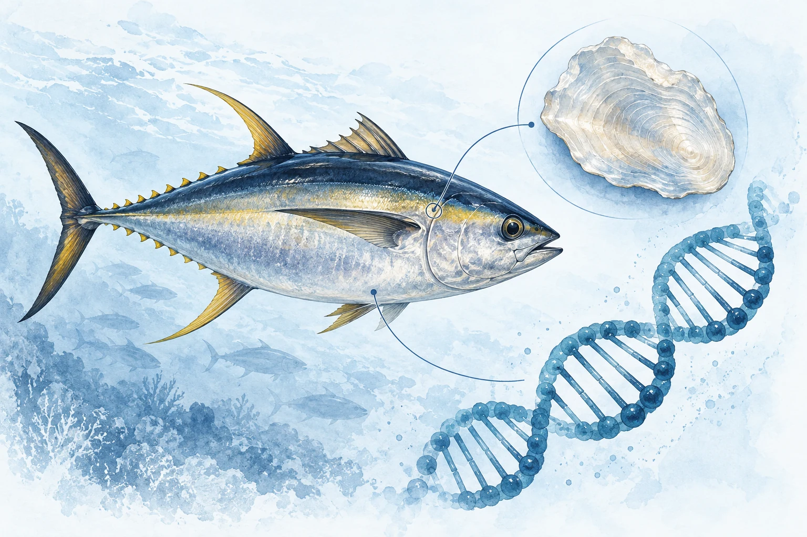
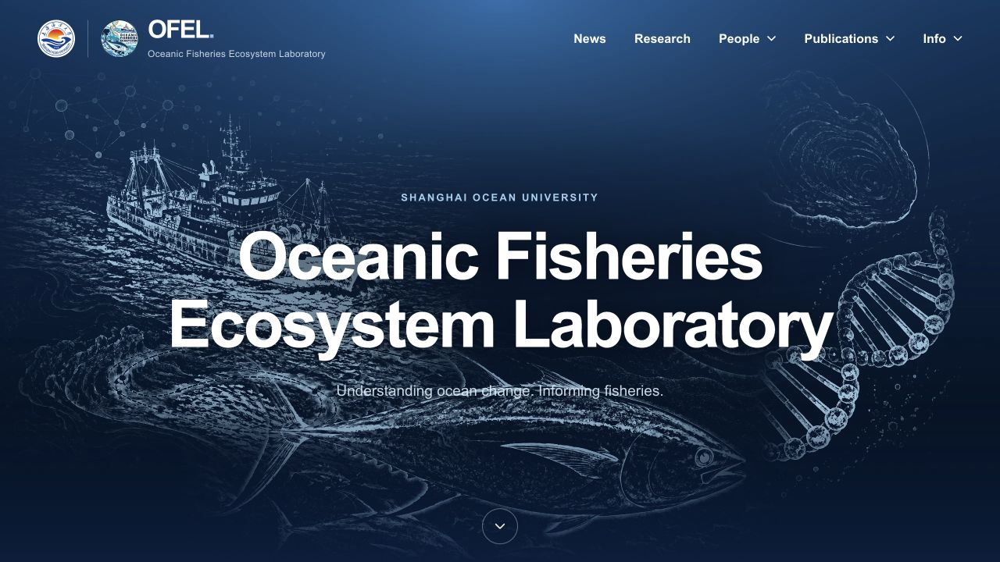
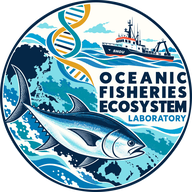

<p align="center">
  <a href="https://fanzhang-lab-shou.github.io/OFEL/">
    
  </a>
</p>

<h1 align="center">大洋渔业生态系统实验室</h1>

<p align="center">
  <strong>Oceanic Fisheries Ecosystem Laboratory · OFEL</strong><br>
  Shanghai Ocean University · 上海海洋大学
</p>

<p align="center">
  <a href="https://fanzhang-lab-shou.github.io/OFEL/"></a>
  <a href="https://fanzhang-lab-shou.github.io/OFEL/research/themes.html"></a>
  <a href="https://fanzhang-lab-shou.github.io/OFEL/contact.html"></a>
</p>

<p align="center">
  <a href="https://github.com/FanZhang-LAB-SHOU/OFEL/actions/workflows/pages.yml"></a>
  &nbsp; <a href="#research--研究方向">研究方向</a> · <a href="#explore--走进实验室">网站导航</a> · <a href="#local-preview--本地预览">本地预览</a> · <a href="docs/MAINTAINING.md">维护指南</a>
</p>

---

我们研究鱼类种群如何变化、捕捞活动如何发生，以及生物学过程如何影响资源评估与管理。通过种群模型、渔船轨迹数据和生物学证据，支持海洋渔业资源的科学养护与可持续利用。

OFEL studies fish population dynamics, fishing activity, and marine life to inform fisheries assessment and management. This repository hosts the laboratory’s website, including our research, people, publications, and news.

## Research · 研究方向

<table>
  <tr>
    <td width="33%" valign="top">
      <a href="https://fanzhang-lab-shou.github.io/OFEL/research/themes.html#population-assessment"></a>
      <br><sub>01 / POPULATIONS</sub>
      <h3>Population dynamics &amp; stock assessment</h3>
      <p>种群动力学与资源评估</p>
      <p>Quantitative models of growth, recruitment, mortality, and population change.</p>
    </td>
    <td width="33%" valign="top">
      <a href="https://fanzhang-lab-shou.github.io/OFEL/research/themes.html#vessel-ai"></a>
      <br><sub>02 / FISHERIES DATA</sub>
      <h3>AI &amp; fishing-vessel behavior</h3>
      <p>人工智能与渔船行为</p>
      <p>Vessel-tracking data and AI to study fishing activity, effort, and fleet dynamics.</p>
    </td>
    <td width="33%" valign="top">
      <a href="https://fanzhang-lab-shou.github.io/OFEL/research/themes.html#biology-dna"></a>
      <br><sub>03 / BIOLOGY &amp; DNA</sub>
      <h3>Fish biology &amp; DNA research</h3>
      <p>鱼类生物学与 DNA 研究</p>
      <p>Life histories, biological observations, and genetic evidence of population structure.</p>
    </td>
  </tr>
</table>

**延伸研究**　[Climate change & marine ecosystems](https://fanzhang-lab-shou.github.io/OFEL/research/themes.html#climate-ecosystems) · [Climate-adaptive fisheries management](https://fanzhang-lab-shou.github.io/OFEL/research/themes.html#adaptive-management)

## Explore · 走进实验室

| | 入口 | 内容 |
| :---: | :--- | :--- |
| **01** | [Research / 研究](https://fanzhang-lab-shou.github.io/OFEL/research/themes.html) | Research Themes：三个核心方向与两项延伸研究；[Collaborators](https://fanzhang-lab-shou.github.io/OFEL/research/collaborators.html) |
| **02** | [People / 成员](https://fanzhang-lab-shou.github.io/OFEL/members/index.html) | 教师、博士后和研究生；[校友](https://fanzhang-lab-shou.github.io/OFEL/members/alumni.html) |
| **03** | [Fan Zhang / 张帆](https://fanzhang-lab-shou.github.io/OFEL/members/fan-zhang.html) | Professor & Doctoral Supervisor |
| **04** | [Publications / 论文](https://fanzhang-lab-shou.github.io/OFEL/publications.html) | 实验室与 Fan Zhang 论文集合、主题筛选、BibTeX |
| **05** | [News / 动态](https://fanzhang-lab-shou.github.io/OFEL/news/index.html) | 研究进展、成员消息与学术活动 |
| **06** | [Contact & Join Us / 联系与加入](https://fanzhang-lab-shou.github.io/OFEL/contact.html) | 合作、访问与研究生培养 |
| **07** | [Resources / 资源](https://fanzhang-lab-shou.github.io/OFEL/resources/software.html) | ALSCL 软件、在线文档与参考资料入口 |

## Website · 网站预览

<a href="https://fanzhang-lab-shou.github.io/OFEL/">
  
</a>

<p align="center"><a href="https://fanzhang-lab-shou.github.io/OFEL/"><strong>打开实验室网站 ↗</strong></a></p>

## Local preview · 本地预览

核心构建仅需 **Python 3**。页面使用 HTML、CSS 和 JavaScript，内容从 JSON 数据与共享模板生成。

```sh
git clone https://github.com/FanZhang-LAB-SHOU/OFEL.git
cd OFEL
python3 scripts/build-site.py
python3 scripts/check-site.py
python3 -m http.server 8765 --bind 127.0.0.1
```

打开 [http://127.0.0.1:8765/](http://127.0.0.1:8765/)。如果端口已被占用，可换成其他空闲端口。

## Maintain · 更新内容

| 要更新的内容 | 编辑位置 |
| :--- | :--- |
| 研究方向与封面 | [`assets/research.json`](assets/research.json) |
| 成员、照片与联系方式 | [`assets/people.json`](assets/people.json) |
| 论文与个人主页发表列表 | [`assets/publications.json`](assets/publications.json) · [`assets/member-publications.json`](assets/member-publications.json) |
| 新闻稿与封面 | [`assets/blog.json`](assets/blog.json) · [`assets/news/`](assets/news/) |
| 页面结构、导航与页脚 | [`templates/`](templates/) |
| 样式与交互 | [`styles.css`](styles.css) · [`script.js`](script.js) |

修改数据或模板后，运行构建与检查，再提交源文件及生成页面。推送到 `main` 后，[GitHub Actions](https://github.com/FanZhang-LAB-SHOU/OFEL/actions/workflows/pages.yml) 会重新构建、检查链接并部署 GitHub Pages。

**[阅读完整维护指南 →](docs/MAINTAINING.md)**

---

<p align="center">
  <br>
  <strong>大洋渔业生态系统实验室</strong><br>
  <sub>Oceanic Fisheries Ecosystem Laboratory · Shanghai Ocean University</sub><br><br>
  <a href="mailto:f-zhang@shou.edu.cn">f-zhang@shou.edu.cn</a> · <a href="https://fanzhang-lab-shou.github.io/OFEL/">Website</a>
</p>
